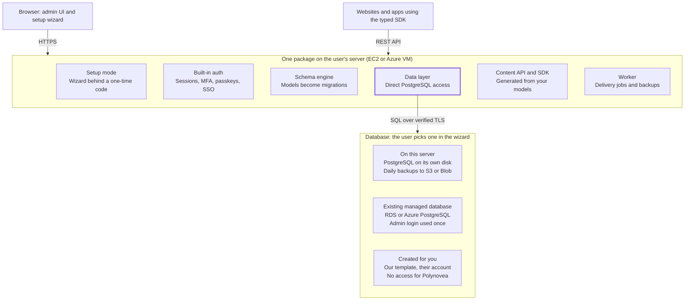
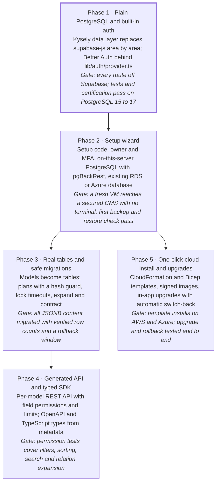

# Polynovea CMS: Self-Hosted Platform Upgrade Design

22 November 2026 · Subrojit Roy

Companion document: [Upgrade Implementation Plan](Polynovea%20CMS%20Upgrade%20Implementation%20Plan.md)

## Summary

Polynovea CMS becomes a self-hosted platform that a non-technical person can install from the browser. They deploy one package to their own AWS or Azure server, open the URL, enter a one-time setup code, and a wizard does the rest: choose a database, create the owner account, then build their own tables and get an API and typed SDK for them.

The headline decisions:

- **Plain PostgreSQL is the foundation.** The CMS stops depending on Supabase's PostgREST and GoTrue services, so it can run on any PostgreSQL 15+ database: on the same server, on RDS or on Azure.
- **Auth is built in, using a proven library, never written from scratch.** It is for the people using the CMS (admins, editors, API and agent identities), not for the end users of our customers' own apps.
- **Three database options in the wizard:** PostgreSQL on this server (with automatic off-server backups), an existing managed database the user connects, or one we create in their cloud account for them.
- **User-defined models become real PostgreSQL tables,** changed only through reviewed, reversible migrations, with a generated REST API and typed SDK.
- **Security is part of the install, not an afterthought:** a locked setup screen, least-privilege database roles, credentials used once and discarded, encrypted secrets, signed releases.

The work ships in five phases. The first, plain-Postgres support with built-in auth, is the largest and unblocks everything else.

## Where OSS1 is today

Most of the building blocks exist; the blocker is that every data and login call goes through Supabase's hosted-style services. Figures below are from the merged `main` (commit e133a80).

| Area | What exists | Gap for this upgrade |
| --- | --- | --- |
| Data access | 149 API routes; about 577 `.from()` and 46 `.rpc()` calls through supabase-js into PostgREST | Needs a direct PostgreSQL data layer; PostgREST is not on a plain RDS or VM database |
| Auth | `lib/auth/provider.ts` defines browser and server identity interfaces; one Supabase (GoTrue) implementation | The interface is typed on Supabase's `Session` and `User`; needs a built-in provider and neutral types |
| Owner setup | `bootstrap:admin` command-line script | No browser setup flow; no setup-code protection |
| Database checks | `lib/infrastructure/databaseProvisioning.ts` probes a connection (PostgreSQL 15+, TLS), and keeps a checksum migration ledger | Reads its config through Supabase; no role creation or connectivity diagnosis |
| Migrations | 69 SQL migrations plus `db:migrate`; TLS verification already supports RDS and Azure CA bundles | Many functions assume Supabase roles (`anon`, `authenticated`, `service_role`) |
| Content models | Canonical schema, field registry, schema diff and a compiler contract that already names "PostgreSQL migration intent" | Entries are stored generically: each version is a JSONB payload in `content_entry_versions`, not a real table per model |
| SDK and tools | `packages/cms-sdk`, `cms-cli` and `cms-mcp` | SDK is generic, not typed from the user's models |
| Background work | `delivery-worker.mjs` runs delivery jobs | Fine as is; setup work belongs in the installer, not here |

The network guard, error sanitising and TLS work from the October audit carry straight over: they are exactly what a wizard that accepts database addresses needs.

## Target architecture

Everything runs as one package on the user's server; only the database location changes between the three options.

The data layer is the foundation: every other box reads and writes through it, and it is what lets the same package run against any of the three databases.

- **Setup mode and running mode.** A fresh install has no database, so the app starts in setup mode: only the wizard is reachable, and it saves the database connection encrypted on the server's disk. Once migrations finish and the owner exists, setup mode switches off for good and the normal app starts.
- **One package.** A container image (and a VM image built from it) holds the app, the worker and, for the "on this server" option, PostgreSQL itself. Upgrades replace the package and run pending migrations.
- **No extra services.** No PostgREST or GoTrue: auth and data access live inside the app, so the only moving parts are the app, the worker, the database and object storage.

## First-run setup wizard

The wizard is the most exposed screen we ship: until the owner exists, whoever reaches it first owns the install. In 2017 attackers scanned for unfinished WordPress installs, pointed them at their own database and took over the host ([Wordfence](https://www.wordfence.com/blog/2017/07/wpsetup-attack/)). Jenkins defends with a random first password printed to the log and saved on disk ([Jenkins](https://www.jenkins.io/doc/book/installing/linux/)); Gitea locks its installer with `INSTALL_LOCK` ([Gitea](https://docs.gitea.com/administration/config-cheat-sheet)). We do both.

**Setup code**

- Generated at first boot from a secure random source, at least 128 bits, shown as a short readable code.
- Printed only to the server log and the deploy output, with the setup URL, and only while the install has no owner.
- Stored as a hash and compared in constant time. Expires after 1 hour; a restart issues a new one.
- Sent in the form body, never in the URL, so proxies and access logs never record it.
- Setup endpoints are rate-limited; five wrong codes lock the wizard for 15 minutes.
- For automated deploys, an operator can supply `POLYNOVEA_SETUP_CODE` (stored hashed) instead.

**Locking for good**

- Finishing setup inserts a single `installation` row in the same transaction that creates the owner. A unique constraint means two people finishing at once cannot both win.
- From then on every `/setup` route returns 404, and the app refuses to re-enter setup mode while that row exists.
- While uninitialised, the server logs a warning every few minutes if it is listening on a public address.

**Steps**

1. Enter the setup code.
2. Choose the database (next sections) and watch the checks and migrations run live.
3. Create the owner account: email, password, then enrol a passkey or authenticator app (required).
4. Save the recovery codes and confirm they were saved.
5. Name the organisation and the first workspace.
6. Optional, can be done later: email sender, Google or Microsoft sign-in, file storage, starter content.

Steps 1 to 5 are the minimum to a working, secured CMS. Everything in step 6 has its own settings page, so the wizard never blocks on something the user cannot finish today, such as a DNS change.

## Built-in auth

We embed Better Auth behind our own provider interface, enable only the plugins we need, and hold ourselves to NIST and OWASP rules rather than the library's defaults.

**Why Better Auth.** Lucia is retired: its author turned it into a learning resource in March 2025 ([Lucia](https://lucia-auth.com/lucia-v3/migrate)). Auth.js moved to the Better Auth team in September 2025 and now gets security fixes only ([Better Auth](https://better-auth.com/blog/authjs-joins-better-auth)). Better Auth is the remaining TypeScript option with first-party TOTP, passkeys, organisations, API keys, SSO and rate limiting on PostgreSQL.

**The catch: its security record is heavy.** The November 2026 release alone fixed 12 advisories, including revoked sessions staying valid with a cookie cache and OAuth trusting an unverified provider email ([Vercel bulletin](https://vercel.com/kb/bulletin/better-auth-november-2026-security-release)). Its SSO plugin has had SSRF and provider-registration flaws ([GitLab advisories](https://advisories.gitlab.com/pkg/npm/@better-auth/sso/)). So:

- Pin exact versions of every `@better-auth/*` package together, watch its advisories, and ship security releases within days.
- Enable only core, two-factor, passkey, admin and API key. Never the phone, Expo, Electron or payments plugins. (The implementation plan drops the API key plugin, because our own `developer_api_tokens` already cover it.)
- Keep `lib/auth/provider.ts` as the boundary, with our own `Session` and `User` types, so the library can be swapped without touching the CMS.
- Write our own regression tests for the bug classes it has had: session revocation, email-verified trust on OAuth, attempt-limit races on codes, rate limits behind a proxy and over IPv6.

**Rules we enforce**

| Area | Rule | Source |
| --- | --- | --- |
| Passwords | 15 characters minimum when password is the only factor, 8 with MFA; accept 64+, any Unicode, paste allowed; no composition rules or forced rotation; check against a breached-password list | [NIST SP 800-63B-4](https://pages.nist.gov/800-63-4/sp800-63b.html) |
| Hashing | Argon2id, at least 19 MiB memory, 2 iterations, 1 lane; tuned on the host | [OWASP Password Storage](https://cheatsheetseries.owasp.org/cheatsheets/Password_Storage_Cheat_Sheet.html) |
| MFA | Required for owners and admins; passkey offered first (phishing-resistant), authenticator app as fallback; passkeys require user verification and a strict origin | NIST SP 800-63B-4 |
| Recovery | 10 single-use recovery codes, shown once, stored hashed; owners must register two authenticators; no email-only recovery for the owner | NIST SP 800-63B-4 |
| Sessions | Stored in the database so they can be revoked; `__Host-` cookies, HttpOnly, Secure, SameSite; new session ID on login and role change; idle and absolute timeouts | [OWASP Session Management](https://cheatsheetseries.owasp.org/cheatsheets/Session_Management_Cheat_Sheet.html) |
| Step-up | Re-authenticate before creating API tokens, changing sign-in or email settings, exporting data or changing roles | OWASP Session Management |
| Abuse | Per-account and per-IP throttling with no hard lockout; at most 100 consecutive failures per authenticator; generic error messages | NIST SP 800-63B-4 |

**Owner lockout.** If the owner loses every authenticator and code, recovery is an operator action on the server (a command that issues a fresh one-time code, like the setup code), not an email link.

**Sign-in methods.** Email and password plus MFA at launch, then Google and Microsoft sign-in. The wizard shows the exact callback URL to paste and tests the round trip. SAML comes last, limited to the owner, with discovery URLs passed through our network guard and domain ownership verified.

**Scope.** This auth is for CMS users and API or agent identities. Sign-up for our customers' own end users is a different product and out of scope.

## Database options

The wizard offers three options. A managed database is the recommended default for anyone who cannot look after a server; "on this server" is for small sites and trials, and only with automatic backups.

| Question | On this server | Existing managed database | Created for you |
| --- | --- | --- | --- |
| What the user gives | Nothing | Endpoint name, port, admin login | A click to launch our template in their own account |
| Who looks after backups | Us, through pgBackRest | AWS or Azure | AWS or Azure |
| Cost | Included in the VM | Their RDS or Azure bill | Their RDS or Azure bill, shown before creating |
| Best for | Trials, small sites | Teams with a cloud admin | Non-technical users who want it done right |

**On this server**

- PostgreSQL runs from the package on its own data disk (a separate EBS volume or managed disk), never the VM's root disk.
- pgBackRest archives every WAL change and takes a daily full backup to an S3 bucket or Blob container, encrypted on the client, using the VM's own cloud role so no keys sit in config ([pgBackRest guide](https://pgbackrest.org/user-guide.html)). This gives point-in-time restore.
- Setup is not finished until a first backup and a restore check both pass. GitLab's 2017 outage happened because five backup methods had silently failed and no one had ever restored one ([GitLab postmortem](https://about.gitlab.com/blog/postmortem-of-database-outage-of-january-31/)).
- The dashboard always shows the last successful backup and the last restore test, and alerts on failure through more than email.
- The wizard says plainly that this option makes the user responsible for the server's disk, patches and uptime.

**Existing managed database**

The user pastes the endpoint name (not an IP, which changes) and an admin login. The wizard then runs these checks in order and turns each failure into a plain fix:

1. DNS resolves. Failure on a private endpoint: "this server can't see the database's private network".
2. TCP connects within 5 seconds. Timeout: "allow this server in the database's security group or network rules".
3. TLS verifies the certificate and hostname (`verify-full`) against the CA bundle we ship: the RDS global bundle, or DigiCert Global Root G2 plus Microsoft RSA Root CA 2017 for Azure ([AWS](https://docs.aws.amazon.com/AmazonRDS/latest/UserGuide/UsingWithRDS.SSL.html), [Microsoft](https://learn.microsoft.com/en-us/azure/postgresql/flexible-server/concepts-networking-ssl-tls)). We trust roots only, because both clouds rotate intermediates without notice.
4. The login works and can create roles.
5. PostgreSQL is version 15 or later.

**Use the admin login once, then forget it**

The admin login is held in memory for that one request and never saved. With it the installer:

- creates a `polynovea_owner` role that owns the schema and runs migrations;
- creates a `polynovea_app` login that can only read and write rows, never create or alter tables, and is granted access to future tables through default privileges;
- adds a row-level security policy for `polynovea_app` on every table: all 140 tables have row-level security switched on, which Supabase's service role bypasses but our app login does not;
- runs `REVOKE CREATE ON SCHEMA public FROM PUBLIC`, since databases upgraded from before PostgreSQL 15 still allow it ([PostgreSQL docs](https://www.postgresql.org/docs/current/ddl-schemas.html));
- saves only the `polynovea_app` and `polynovea_owner` passwords, encrypted, in Secrets Manager or Key Vault when available, otherwise in a root-only file.

The runtime never runs as the owner, which also keeps row-level security meaningful.

**Connection details that bite**

- node-postgres drops a separately passed CA certificate if `sslmode` appears in the connection string ([node-postgres](https://node-postgres.com/features/ssl)). We parse the address ourselves and build the TLS settings explicitly, as `postgresTls.mjs` already does.
- One small connection pool per process (about 10 connections), with connection, idle and statement timeouts. RDS Proxy and PgBouncer are not needed for a single server.
- RDS IAM login and Azure Entra login (short-lived tokens, no stored password) come later as an option; tokens must be fetched fresh for each new connection ([AWS IAM auth](https://docs.aws.amazon.com/AmazonRDS/latest/UserGuide/UsingWithRDS.IAMDBAuth.html)).

**The address field is an SSRF risk.** A screen that connects to any host a user types can be used to probe the internal network. Managed databases legitimately live on private addresses, so we cannot block private ranges outright. The rule: private addresses are allowed only for `*.rds.amazonaws.com`, `*.postgres.database.azure.com` or an operator allowlist; loopback, link-local and cloud metadata addresses are always blocked; the address is resolved once and the connection goes to that exact IP; the screen only exists in setup mode behind the setup code. The `guardedNetwork` module from the October audit does most of this already. The VM also requires IMDSv2, so even a successful probe cannot read the server's cloud credentials ([AWS IMDS](https://docs.aws.amazon.com/AWSEC2/latest/UserGuide/configuring-instance-metadata-service.html)).

**Created for you** works the same way after the database exists; how it gets created is in the cloud provisioning section.

## User-defined tables and the SDK

Each model the user creates becomes a real PostgreSQL table, described by our metadata tables and changed only by reviewed migrations. This is the Directus approach: a collection is "a database table plus metadata", and removing the metadata leaves a clean, usable database ([Directus](https://directus.com/docs/guides/data-model/collections)).

**Why move off the JSONB store.** Today every entry version is one JSONB document. Real tables give native types, foreign keys, indexes, unique constraints and row-level security, and make the generated API and SDK simple. Drafts and workflow stay, and current content moves into a table per model. Version history stays as JSONB snapshots, because it is written once and never queried by field (see the implementation plan, phase 3). Existing content migrates model by model.

**How a change happens**

1. The user edits a model in the UI.
2. The schema engine (the existing canonical schema, diff and compiler contract) produces a migration plan and shows it in plain words: "adds a field", "renames a field (safe, two steps)", "deletes 1,240 values".
3. The plan carries a hash of the schema it was built from. Applying it is refused if the schema changed in the meantime ([Directus schema API](https://docs.directus.io/reference/system/schema)).
4. Additive changes apply straight away. Destructive ones need the user to type the model name and are kept as a separate, later step.
5. The migration runs under the owner role, not the app role, and is recorded in the migration ledger with who asked for it.

**Avoiding outages from schema changes**

- Every DDL statement runs with a short `lock_timeout` (about 3 seconds) and retries with backoff. A blocked `ALTER TABLE` otherwise queues every query behind it; GoCardless lost 15 seconds of traffic exactly this way ([GoCardless](https://gocardless.com/blog/zero-downtime-postgres-migrations-the-hard-parts/)).
- Adding a column with a constant default does not rewrite the table; we avoid volatile defaults ([PostgreSQL ALTER TABLE](https://www.postgresql.org/docs/current/sql-altertable.html)).
- Making a field required on existing data uses a `NOT VALID` check, then validation, then `SET NOT NULL`, so the table is not locked during the scan.
- Indexes are built `CONCURRENTLY`.
- Renames and type changes use expand and contract: add the new column, write to both, backfill, switch reads, drop the old one later. pgroll implements this pattern and is worth evaluating rather than rebuilding it ([pgroll](https://github.com/xataio/pgroll)).

**Security of runtime DDL**

- Table and field names must match `^[a-z][a-z0-9_]{0,62}$`, are checked against PostgreSQL reserved words and our own system prefixes, and are always quoted as identifiers, never concatenated.
- Caps per install on tables, fields per table and indexes.
- Only roles with the schema permission can change models; every change is audited.
- Deleting a field also deletes its permission rows in the same transaction, and a deleted name cannot be reused straight away. Directus had a 2025 advisory where a new field silently inherited a deleted field's permissions ([GHSA-9x5g-62gj-wqf2](https://github.com/directus/directus/security/advisories/GHSA-9x5g-62gj-wqf2)).

**The generated API**

- REST endpoints per model, with filtering, sorting, paging and relations.
- Field permissions apply everywhere a field can leak: response fields, filters, sorting, search and relation expansion. Strapi had several advisories where admins could filter on private fields and infer password hashes, or populate fields they could not read ([GitLab advisory](https://advisories.gitlab.com/npm/@strapi/strapi/CVE-2023-22894/)).
- Writes accept only an allowlist of fields; one sanitiser handles both input and output.
- Limits per role, borrowed from Hasura's checklist: page size, filter depth, number of joins, a per-request `statement_timeout`, and a rate limit ([Hasura](https://hasura.io/docs/2.0/security/api-limits/)).
- Webhooks, scheduled jobs, previews and the MCP server go through the same permission checks as the API. Directus's advisories show side channels are where these checks get missed.

**The typed SDK**

- The CMS serves an OpenAPI document and a TypeScript types file built from its own metadata, not from raw database introspection (which gets view nullability and JSON types wrong, as Supabase notes ([Supabase](https://supabase.com/docs/guides/api/rest/generating-types))).
- `polynovea-cms types pull` writes the file into the user's project; CI can fail when it drifts.
- Each schema version has a hash that the API returns and the SDK sends. Adding fields is a minor change; removing or renaming them is a major change, and the SDK warns before it breaks.

## Cloud provisioning ("created for you")

The strongest and simplest design gives Polynovea no access to anyone's cloud account: the user launches our template in their own account, and the template creates everything. Cross-account access only comes in if we later run a hosted control plane.

**Path 1, the default: one-click templates the user runs.**

- AWS: a CloudFormation template opened through a quick-create link. It creates the VM, an RDS PostgreSQL database, an S3 bucket, a Secrets Manager secret and a narrowly scoped instance role ([AWS quick-create links](https://docs.aws.amazon.com/AWSCloudFormation/latest/UserGuide/cfn-console-create-stacks-quick-create-links.html)). Azure: the same as a Bicep template behind a "Deploy to Azure" button.
- The user sees our template and its permissions before clicking, and ticks AWS's IAM acknowledgement themselves. Values in the link can be edited by the user, so nothing trust-critical goes in the URL.
- The database password is generated by the cloud (RDS-managed master password, or Key Vault) and never appears in the template, the URL or the VM's user data.
- The VM requires IMDSv2 and puts no secrets in user data, because user data is readable through the metadata service and cloud-init leaves copies on disk ([AWS IMDS](https://docs.aws.amazon.com/AWSEC2/latest/UserGuide/configuring-instance-metadata-service.html)). The instance role can read exactly one secret.
- When the package starts, the wizard finds the database through the stack's tags and secret, so the "database" step is already done; it then creates the limited `polynovea_app` role as in the previous section.
- Defaults are cheap and safe: a small burstable VM, a single-zone small database with deletion protection and automatic backups on, and an AWS Budgets alert. The template shows the expected monthly cost.

This replaces the idea of the workers creating the database: creation belongs to the template, which the cloud tracks, can roll back and can delete cleanly.

**Path 2: OpenTofu modules for technical teams.** The same resources as published modules, with state kept in the user's own bucket. State holds secrets in plain text, so we require OpenTofu's state encryption with a KMS or Key Vault key ([OpenTofu](https://opentofu.org/docs/language/state/encryption/)), `prevent_destroy` on the database and bucket, and a plan shown before every apply. Infracost can show the cost of a plan, but its licence needs checking before we bundle it.

**Path 3, only with a hosted control plane: cross-account access.** If Polynovea later manages installs for customers:

- AWS: the customer creates a role that trusts our account, with an External ID that we generate per customer and never accept from them, to block the confused-deputy attack ([AWS IAM](https://docs.aws.amazon.com/IAM/latest/UserGuide/confused-deputy.html)). We validate onboarding by actually assuming the role, as Datadog does ([Datadog](https://docs.datadoghq.com/integrations/guide/aws-manual-setup/)). No long-lived access keys.
- Shrink access after setup: a bootstrap role creates the resources, then is removed and replaced by a narrow update-only role. ClickHouse's BYOC lets customers keep IAM-write entirely ([ClickHouse](https://clickhouse.com/docs/products/bring-your-own-cloud/onboarding/customization-aws)).
- Prefer a pull model: the install polls for signed updates and applies them with its own role, so our control plane holds no credentials and the install keeps running if we are offline ([Redpanda](https://docs.redpanda.com/redpanda-cloud/security/cloud-security-overview/)).
- Azure: a multi-tenant app with admin consent and a role scoped to one resource group, using workload identity federation instead of a client secret ([Microsoft](https://learn.microsoft.com/entra/workload-id/workload-identity-federation)). Role assignments outlive the app, so offboarding must remove them.

## Security model

The sections above each carry their own controls; this table is the single checklist, by threat.

| Threat | Control |
| --- | --- |
| Someone claims a fresh install first | One-time setup code from the server log, hashed, 1-hour expiry, rate-limited; setup locks for good on a unique `installation` row |
| The database address field is used to probe the network | Setup-mode only, behind the code; resolve once and pin the IP; metadata, loopback and link-local always blocked; private ranges only for known managed-database hostnames; IMDSv2 on the VM |
| A leaked app credential is used to alter or drop tables | The runtime login cannot create, alter or drop; migrations use a separate owner role; admin login used once and never stored |
| Database traffic intercepted | `verify-full` TLS against shipped root CAs; no unverified fallback outside a private network the operator names |
| Account takeover | Argon2id, breached-password check, MFA required for admins, passkeys first, revocable sessions, step-up for sensitive actions, throttling |
| A flaw in the auth library | Exact version pins, only the plugins we need, our own regression tests for its past bug classes, the library kept behind our interface |
| A field or row leaks through the API | Field permissions applied to filters, sort, search and relation expansion as well as output; field allowlist on writes; the same checks on webhooks, jobs, previews and MCP |
| A crafted table or field name injects SQL | Strict name pattern, reserved-word and prefix checks, identifiers always quoted |
| An expensive query takes the site down | Per-role caps on page size, filter depth, joins; per-request statement timeout; rate limits |
| Secrets entered in the UI are stolen from the database | Envelope encryption: AES-256-GCM per secret, data keys wrapped by a master key kept outside the database (file, KMS or Key Vault); write-only fields; key rotation command ([OWASP](https://cheatsheetseries.owasp.org/cheatsheets/Cryptographic_Storage_Cheat_Sheet.html)) |
| Errors leak internals | `clientErrorMessage` (from the October audit) everywhere; wizard checks report plain hints, not raw driver errors |
| A tampered release is installed | Images signed with cosign keyless signing and verified by identity before an upgrade; images pinned by digest; an SBOM per release ([Sigstore](https://docs.sigstore.dev/cosign/signing/overview/)) |
| A cloud template is over-privileged | The user runs it in their own account; one role that reads one secret; no keys in user data; deletion protection on data |
| Nobody notices an attack | Audit log for sign-ins, role and schema changes, secret changes and setup; alerts on repeated failures |

The master key is the one secret that cannot be regenerated. The wizard makes the owner download or copy it, and it is backed up separately from the database backups: a backup and its key stored together protect nothing.

## Operations

A non-technical owner will never run a command, so the System page has to show health, backups and upgrades, and fix the common cases itself.

- **Backups.** Managed databases use the cloud's automated backups (we check they are switched on and warn if retention is under 7 days). "On this server" uses pgBackRest as described above. Either way the System page shows the last backup, the last restore test, and a "restore to a point in time" flow that restores into a new database first, never over the live one.
- **Monthly restore test.** The worker restores the latest backup into a temporary database, runs a row-count and migration-ledger check, then deletes it. A failed test is an alert, not a log line.
- **Upgrades.** The System page shows a new signed release with its changelog. Upgrading takes a backup, verifies the image signature, pulls it by digest, runs pending migrations, checks `/api/health` for the new release ID and switches over; if the health check fails it switches back. Migrations must be backward compatible for one release, so a rollback of the app never needs a rollback of the database.
- **Health.** The existing operability service becomes the System Doctor: database reachable, TLS valid and CA bundle current, disk space, backup age, certificate expiry, pending migrations, worker heartbeat, auth library version against known advisories.
- **Disk and cost.** Alerts at 80 % disk and when the cloud budget alert fires; the "on this server" option warns before the data disk fills.
- **Logs.** Structured logs with the error reference IDs from `clientErrorMessage`, kept for 14 days on the server, with optional shipping to CloudWatch or Azure Monitor.

## Roadmap

Phase 1 comes first because nothing else works without it; phases 3 and 5 can overlap once phase 2's wizard exists. Each phase is closed by an exit gate.

The implementation plan gives weeks, staffing and tasks for each phase. Its estimates stay unmeasured until the phase 0 spike, which moves one area (taxonomy) off supabase-js onto Kysely and the new auth.

## Open decisions and risks

Seven decisions need the owner before phase 1 starts; each has a recommendation.

| Decision | Recommendation | Why |
| --- | --- | --- |
| Data layer for direct PostgreSQL | Kysely | A SQL builder with no code generation step, which handles tables defined at runtime; Drizzle is fine for fixed tables but its migration tooling assumes a static schema; Prisma does not fit runtime tables |
| Stopgap while routes move off Supabase | No long stopgap; move routes area by area behind a feature switch, Supabase path kept until each area passes | Bundling PostgREST means also issuing PostgREST-compatible tokens from the new auth, which is work thrown away later |
| Existing JSONB content | Migrate model by model to real tables, with a verified copy and a rollback window | A dual storage model would double every code path |
| Migration engine | Evaluate pgroll before building our own expand and contract | It already does versioned views, backfill and rollback; needs PostgreSQL 14+ |
| Auth library dependence | Accept Better Auth, behind our interface | No other TypeScript option has the features; the interface keeps a swap possible |
| Hosted control plane (path 3) | Not now; ship templates first | Holding customers' cloud access is a liability we do not need for launch |
| Licence | Decide before launch (MIT, AGPL or FSL) | Matters more once others can host this as a service |

**Telemetry.** If self-hosted installs send any usage or behavioural data back to Polynovea, the wizard must state exactly what, why and how it is used before setup finishes. Decide what we collect before phase 2 ships the wizard.

**Risks**

- Phase 1 is large: about 577 table calls and 46 database function calls across 149 routes move off supabase-js. Mitigation: area by area, with the existing tests and certification scripts per area.
- Auth library advisories arrive often. Mitigation: pins, a fast patch policy and our own regression tests.
- Users choosing "on this server" and losing data. Mitigation: backups are mandatory and tested before setup can finish.
- Several research points were not verified against primary sources (ASVS 5.0 chapter detail, some 2026 advisory version numbers, Infracost licence). Check each before it becomes a requirement.

## Sources

Researched on 22 November 2026. Each link is cited where it is used above.

| Topic | Sources |
| --- | --- |
| Setup takeover | [Wordfence: The WPSetup attack](https://www.wordfence.com/blog/2017/07/wpsetup-attack/) (2017) · [Jenkins: installing on Linux](https://www.jenkins.io/doc/book/installing/linux/) · [Gitea: config cheat sheet](https://docs.gitea.com/administration/config-cheat-sheet) |
| Auth library | [Lucia v3 migration notice](https://lucia-auth.com/lucia-v3/migrate) · [Better Auth: Auth.js joins Better Auth](https://better-auth.com/blog/authjs-joins-better-auth) (22 Sep 2025) · [Vercel: Better Auth November 2026 security release](https://vercel.com/kb/bulletin/better-auth-november-2026-security-release) · [GitLab advisories: @better-auth/sso](https://advisories.gitlab.com/pkg/npm/@better-auth/sso/) |
| Passwords, MFA, sessions, secrets | [NIST SP 800-63B-4](https://pages.nist.gov/800-63-4/sp800-63b.html) · [OWASP Password Storage](https://cheatsheetseries.owasp.org/cheatsheets/Password_Storage_Cheat_Sheet.html) · [OWASP Session Management](https://cheatsheetseries.owasp.org/cheatsheets/Session_Management_Cheat_Sheet.html) · [OWASP Cryptographic Storage](https://cheatsheetseries.owasp.org/cheatsheets/Cryptographic_Storage_Cheat_Sheet.html) |
| Backups | [GitLab: postmortem of the 31 January database outage](https://about.gitlab.com/blog/postmortem-of-database-outage-of-january-31/) (10 Feb 2017) · [pgBackRest user guide](https://pgbackrest.org/user-guide.html) |
| Roles, TLS, credentials | [PostgreSQL: schemas](https://www.postgresql.org/docs/current/ddl-schemas.html) · [AWS: SSL/TLS for RDS](https://docs.aws.amazon.com/AmazonRDS/latest/UserGuide/UsingWithRDS.SSL.html) · [Microsoft: TLS in Azure Database for PostgreSQL](https://learn.microsoft.com/en-us/azure/postgresql/flexible-server/concepts-networking-ssl-tls) (updated 14 Jul 2026) · [node-postgres: SSL](https://node-postgres.com/features/ssl) · [AWS: RDS IAM database authentication](https://docs.aws.amazon.com/AmazonRDS/latest/UserGuide/UsingWithRDS.IAMDBAuth.html) |
| Host hardening | [AWS: instance metadata service](https://docs.aws.amazon.com/AWSEC2/latest/UserGuide/configuring-instance-metadata-service.html) |
| Schema model and changes | [Directus: collections](https://directus.com/docs/guides/data-model/collections) · [Directus: schema API](https://docs.directus.io/reference/system/schema) · [PostgreSQL: ALTER TABLE](https://www.postgresql.org/docs/current/sql-altertable.html) · [GoCardless: zero-downtime Postgres migrations](https://gocardless.com/blog/zero-downtime-postgres-migrations-the-hard-parts/) · [pgroll](https://github.com/xataio/pgroll) |
| API security and SDK | [Directus advisory GHSA-9x5g-62gj-wqf2](https://github.com/directus/directus/security/advisories/GHSA-9x5g-62gj-wqf2) (13 Nov 2025) · [Strapi CVE-2023-22894](https://advisories.gitlab.com/npm/@strapi/strapi/CVE-2023-22894/) · [Hasura: API limits](https://hasura.io/docs/2.0/security/api-limits/) · [Supabase: generating TypeScript types](https://supabase.com/docs/guides/api/rest/generating-types) |
| Provisioning | [AWS: CloudFormation quick-create links](https://docs.aws.amazon.com/AWSCloudFormation/latest/UserGuide/cfn-console-create-stacks-quick-create-links.html) · [AWS: the confused deputy problem](https://docs.aws.amazon.com/IAM/latest/UserGuide/confused-deputy.html) · [Datadog: AWS manual setup](https://docs.datadoghq.com/integrations/guide/aws-manual-setup/) · [ClickHouse BYOC: AWS customisation](https://clickhouse.com/docs/products/bring-your-own-cloud/onboarding/customization-aws) · [Redpanda: cloud security overview](https://docs.redpanda.com/redpanda-cloud/security/cloud-security-overview/) · [Microsoft: workload identity federation](https://learn.microsoft.com/entra/workload-id/workload-identity-federation) · [OpenTofu: state and plan encryption](https://opentofu.org/docs/language/state/encryption/) |
| Supply chain | [Sigstore: cosign signing overview](https://docs.sigstore.dev/cosign/signing/overview/) |
